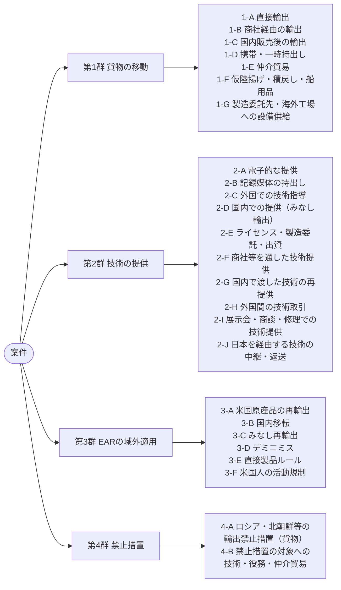
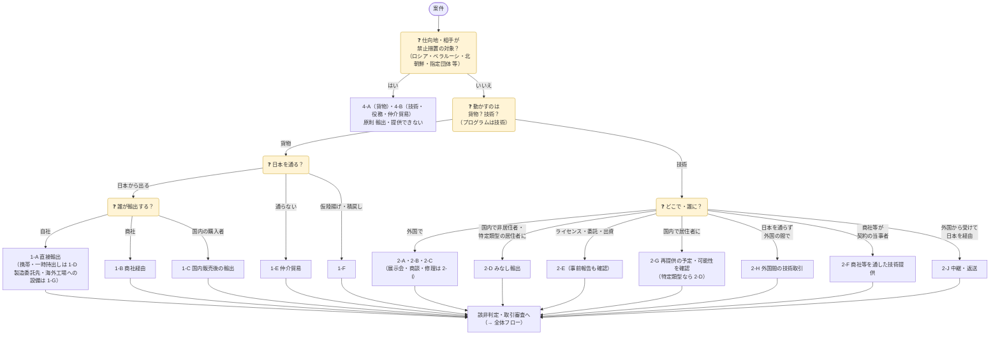
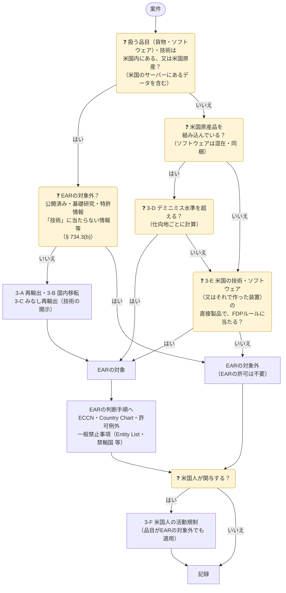

案件が持ち込まれたら、まず「**何を**（貨物か技術か）」「**どう動かすか**（直接か、誰かを経由するか、国内か）」で類型を決めます。類型が決まれば、外為法とEARのどの規定を確認するかがほぼ決まります。

類型コードは審査記録（台帳）に残しておくと、似た案件の判断を後から引けます。

> 2026年11月11日時点の本サイトの各ページ（外為法・輸出令・外為令・役務通達、15 CFR）をもとにした整理です。根拠の詳細は各行のリンク先で確認してください。

## 類型の全体像

1つの案件が複数の類型に当たるのが普通です。たとえば「米国製部品を組み込んだ自社製品を、商社経由で中国へ輸出し、据付に技術者を派遣する」なら、1-B・2-C・3-D（場合により3-E）を確認します。

## 類型ごとの確認事項


{}
| コード | 類型 | 典型例 | 外為法 | EAR | 着眼点 |
|:-:|---|---|---|---|---|
| **1-A** | 直接輸出 | 自社が輸出者として海外の顧客・**自社の海外子会社**へ出荷 | 48条1項。輸出令別表第1の**1〜15項**（リスト規制）・**16項**（キャッチオール）。特例は輸出令第4条 | 日本にある米国原産品などを日本から出すのは「輸出」ではなく**再輸出**（§ 734.14）→ 3-A・3-D・3-E | 自社グループ内でも輸出。契約上の買主と**実際の需要者**が同じか |
| **1-B** | 商社・代理店経由の輸出 | 国内の商社に売り、商社が輸出者になる | 許可を取るのは**輸出する者**（通常は商社）。メーカーは該非判定書・需要者情報を正しく渡す | EARの対象品なら、商社・フォワーダーを含め取引に関わる者すべてが違反の主体になり得る（§ 764.2） | 「国内向けの販売だから関係ない」と考えない。該非判定書の版・前提スペックが出荷品と一致しているか。技術の場合は 2-F |
| **1-C** | 国内販売後の輸出 | 国内の顧客が購入後に海外へ転売・持出し。国内で外国人旅行者・外国企業の担当者・外国企業の日本支店に引き渡し、相手が持ち出す（貨物版の 2-D） | 国内での販売そのものは輸出ではなく、許可は要らない。ただし無許可輸出を**知りながら**手助けすれば、共犯として責任を問われ得る | 対象品なら、販売先の変更は国内移転（3-B）、購入者の輸出は再輸出。「知り得べき理由」（reason to know）も knowledge に含まれる（§ 772.1） | 顧客の業態（輸出商社・ブローカー）、外国仕様の電源・外国語マニュアルの要求、納入先が保税地域・港湾、該非判定書だけを求められる。技術の場合は 2-G |
| **1-D** | 携帯・一時持出し | 出張者のPC・サンプル・測定器、展示会への出品、修理品の返送、デモ機の貸出し | 手荷物・別送品・無償・一時的でも**輸出**。特例は無償告示の類型に当たる場合だけ（→ [05 無償特例](../../05-exceptions/#無償特例無償告示)） | 許可例外 **BAG**（§ 740.14）・**TMP**（§ 740.9）などの条件を確認（→ [許可例外](../../10-us-ear/license-exceptions/)） | 無償告示に**無償サンプル・営業用の貸出し・日本からの展示会出品**の類型はない。展示後の現地売却・譲渡を契約で止める。技術の場合は 2-B・2-I |
| **1-E** | 仲介貿易（三国間） | 貨物は日本を通らず、A国からB国へ。日本企業が売買契約の当事者 | 25条4項・外為令17条5項。<strong>1項（武器）</strong>は全部。**2〜16項**は、船積地域・仕向地の**どちらもグループA以外**で、大量破壊兵器等の開発等に使われるおそれ（省令の要件・インフォーム）がある場合 | 日本企業が手配しても、EARの対象品の再輸出・移転には許可の要否がある。無許可を知りながら手配すれば § 764.2 の違反になり得る | 貨物が日本の税関を通らないので、社内審査だけが歯止め。船積書類・原産地・最終仕向地を照合。技術の場合は 2-H |
| **1-F** | 仮陸揚げ・積戻し・船用品 | 日本で積み替える外国貨物、保税地域からの積戻し、外国貿易船への船用品 | **外国向け仮陸揚げ貨物**は輸出令第4条第1項第1号で原則許可不要。ただし**1項**の貨物は許可が必要で、グループA以外向けは大量破壊兵器等のおそれ（省令の要件・インフォーム）があれば許可が必要。船用品・航空機用品は第2号イ（1項を除く） | 第三国での積替え・通過も再輸出。ロシア・ベラルーシなど特定国での積替え・通過は一般禁止事項8（§ 736.2(b)(8)） | 保管中の荷受人・仕向地の変更、船荷証券の仕向地と実際の行き先の食い違い。洋上での瀬取り（積替え）は北朝鮮制裁の典型的な回避手口。技術の場合は 2-J |
| **1-G** | 製造委託先・海外工場への設備・材料の供給（貨物版の 2-E） | 製造委託先・合弁会社・自社の海外工場へ、製造装置・金型・治具・検査装置・材料・部品を送る。工場の海外移設（使っていた設備の輸出）、設備の現物出資 | 48条1項。**中古品・自社で使っていた設備**でも該非判定が要る（改造・増設で仕様が変わっていないか）。工作機械・製造装置・検査装置はリスト規制に当たりやすく、非該当でも委託先・合弁先の用途によってはキャッチオール。重要管理対象技術の事前報告は技術を提供する取引が対象で、設備の輸出だけなら報告は要らない（→ [報告告示](../../09-laws/critical-tech-report/)）。出資の形をとる場合、業種によっては対外直接投資の事前届出（外為法23条。財務大臣あて）が別に要ることがある | 米国製の製造装置を移設・転売すれば再輸出（3-A）。中国などへの半導体製造装置は、§ 744.23 や直接製品ルール（3-E）を確認。委託先で作った製品が直接製品ルールに当たるかも確認 | 一緒に渡す製造技術は 2-E、据付・立上げの指導は 2-C として別に判断する。委託先・合弁先が設備を他の顧客（軍需など）向けの生産に使わないか。契約終了後の設備の返還・廃棄の取決め |
{}
{}
| コード | 類型 | 典型例 | 外為法 | EAR | 着眼点 |
|:-:|---|---|---|---|---|
| **2-A** | 電子的な提供 | 図面のメール送信、海外拠点から国内サーバー・クラウドへのアクセス、ソフトウェアのダウンロード提供、リモート保守 | 25条1項（提供する取引）。特定技術を記録した媒体の輸出・**電気通信による送信**は25条3項（取引の許可を受けていれば不要） | 技術・ソースコードの開示（release、§ 734.15）は輸出・再輸出に当たる。一定の条件で**エンドツーエンド暗号化**した送信・保管は輸出に当たらない（§ 734.18(a)(5)） | 「提供」は相手が**利用できる状態に置く**こと。閲覧権限（アクセス権）・共有リンクの範囲、退職者・海外拠点のアカウント |
| **2-B** | 記録媒体の持出し | 出張者のPC・スマートフォン・USBメモリに入った技術データ、紙の図面 | 25条1項・3項（特定記録媒体等の輸出）。PC本体は貨物として別に判断（暗号機能は9項。携帯品の特例は 1-D） | 媒体に入った技術を持ち出せば再輸出。PC等は BAG・TMP の条件を確認 | 自分だけが使い、現地で誰にも見せない・渡さないなら、原則として「提供」に当たらない（相手が利用できる状態に置かないため）。現地の同僚に見せれば、相手が日本人でも外国での提供（2-C）。不要なデータを消してから持ち出す。現地での紛失・入国時の検査で第三者に見られるリスク |
| **2-C** | 外国での技術指導・役務 | 技術者の派遣による据付・保守・修理・研修・コンサルティング | 25条1項。**外国で**の提供は、相手が居住者（日本人の同僚など）でも対象。輸出した貨物の据付・操作・保守のための最小限の使用技術は例外あり（→ [05](../../05-exceptions/)） | 現地での開示は再輸出・みなし再輸出（3-C）。派遣者が米国人なら § 744.6（3-F） | 契約外の改造・性能向上の指導、口頭での設計ノウハウの説明は例外の範囲外になりやすい |
| **2-D** | 国内での提供（みなし輸出） | 国内での外国人社員・留学生・研究者・客先技術者への説明、資料の閲覧。試作品・装置の内部を見せる、公開の見学コースではない工場見学 | 25条1項。相手が**非居住者**、又は**特定類型**（2022年5月1日から。①外国法人等との契約で指揮命令に服する ②外国政府等から年間所得の**25%以上**の利益 ③外国政府等の指示・依頼）の居住者（→ [04 みなし輸出](../../04-technology-transfer/#みなし輸出)） | 米国内での外国人（米国市民・永住権者・保護対象の個人以外）への開示は**みなし輸出**（§ 734.13(b)）。日本国内では 3-C を確認 | 入社・着任・入学時の誓約書、兼業・資金受入れの申告制。日本人も特定類型の確認対象。貨物を見せるだけでも、規制技術が見て取れれば「提供」になり得る（公知になるのは不特定多数向けの見学コースだけ）。国内で非居住者に貨物そのものを渡す場合は 1-C |
| **2-E** | ライセンス・製造委託・出資に伴う提供 | 海外企業への技術ライセンス、製造委託先への製造技術の提供、合弁会社への出資と技術移転 | 25条1項。リスト規制に当たらなくても、**重要管理対象技術**をグループA以外へ提供する場合は**契約前に報告**（55条の8、→ [報告告示](../../09-laws/critical-tech-report/)） | 提供する技術に米国由来の技術が混在・由来すれば、再輸出・デミニミス（技術。事前に BIS へ1回限りの報告）を確認 | 契約交渉の段階で提供する資料も「提供」。製造委託先が作った製品が直接製品ルール（3-E）に当たらないか。一緒に送る設備・金型・材料は 1-G |
| **2-F** | 商社・エンジニアリング会社を通した技術提供（技術版の 1-B） | プラント・設備の案件で、商社やエンジニアリング会社が海外の顧客と契約し、自社は図面・仕様書の作成や技術者の派遣を受け持つ | 許可が要るのは、外国で提供する取引・外国の非居住者に提供する取引を行う者（25条1項）。商社が契約の当事者でも、自社が図面を海外の顧客へ**直接送る**、又は技術者を**派遣する**なら、自社も提供する者に当たり得る。誰が申請するか、許可の範囲に実際の提供者・提供方法が入っているかを事前に整理する | EARの対象の技術なら、関わる者すべてが違反の主体になり得る（§ 764.2）。現地での開示は再輸出・みなし再輸出（3-C） | 技術には通関がないので、誰が提供する者かは契約と実際の提供経路で決まる。契約書の当事者と、実際に技術を渡す者・渡す経路を分けて確認する |
| **2-G** | 国内で渡した技術の再提供（技術版の 1-C） | 国内の委託先・共同研究先・**外国企業の日本支店**に渡した図面が、その海外拠点・本社へ送られる | 国内の居住者への提供そのものは、原則として許可は要らない（相手が特定類型なら 2-D）。外国で提供する者・非居住者に提供する者は、受け取った側として自ら許可を取る。ただし25条1項は「提供することを**目的とする取引**」を対象にしているので、外国での提供が契約で予定されていれば、最初の取引から許可の要否を確認する。申請時に再提供を明らかにして許可を受ければ、受け取った者の再提供は許可不要（貿易外省令第9条第2項第4号） | EARの対象の技術なら、受け取った者による外国への送信は再輸出、外国籍の社員への開示はみなし再輸出（3-C）、別の需要者・用途への移転は国内移転（3-B） | 技術は税関を通らないので、貨物より気づきにくい。外国法人の日本支店は外為法では**居住者**だが、本社と情報を共有していることが多い。契約に再提供の制限（事前同意）を入れ、該非判定の結果を相手に伝える |
| **2-H** | 外国間の技術取引（技術版の 1-E） | 海外子会社・海外拠点が持つ技術を、日本を経由せずに第三国の顧客へ提供する契約を、日本の本社が結ぶ | 25条1項の前半は「特定国において提供することを目的とする取引を行おうとする**居住者**」なので、技術が日本を通らなくても対象。外国で受け取った技術を、日本からの持出し・送信や技術を持つ者の出国を伴わずに提供する取引（<strong>外国間等技術取引</strong>）は許可不要（貿易外省令第9条第2項第5号・第6号）。ただし、居住者が行う取引で、記録媒体の外国相互間の移動や外国から外国への送信を伴うものは、1項の技術ならすべて、2〜16項の技術ならグループA以外の外国の間で大量破壊兵器等のおそれ（告示の要件・インフォーム）がある場合に、この例外から外れる | 海外拠点が持つ技術がEARの対象なら、第三国への提供は再輸出（3-A）。関わる社員に米国人がいれば 3-F | 技術が日本を通らないので、社内審査だけが歯止め（1-E と同じ）。海外拠点の技術が日本から渡ったものなら、外国間等技術取引の例外には当たらない。日本のサーバー・社員を経由させた場合も同じ（2-J） |
| **2-I** | 展示会・商談・デモ・修理での技術提供（技術版の 1-D） | 海外の展示会・商談での説明や資料配布、評価用のデータ・ソフトウェアの提供、デモ機の操作説明、修理品の返送に添える修理報告・不具合の解析結果 | 無償・一時的・口頭でも「提供」（25条1項）。技術には無償特例・少額特例に当たる例外はない。主な例外は、不特定多数が入手・聴講できる展示会・講演会での提供や、公開を目的とする配布資料の送付（<strong>公知の技術</strong>、貿易外省令第9条第2項第9号）と、貨物の輸出に付随する据付・操作・保守・修理の必要最小限の技術（同第12号。性能向上や設計・製造と同等の技術は除く）。評価用のソフトウェアは、市販プログラム（同第14号イ）に当たらなければ該非判定が要る（→ [05 技術提供の例外](../../05-exceptions/#技術提供の例外役務)） | 一般に公開する会議・展示会での開示は、公開済み（published、§ 734.7）としてEARの対象外になり得る。特定の相手への開示は再輸出・みなし再輸出（3-C） | 発表資料・配布資料を事前に審査する。「展示会だから公知」とは限らない：来場者を限った非公開の場や、秘密保持契約を結んだ商談での説明は公知に当たらない（特定の者への提供を目的として公知とする取引も例外にならない）。商談の後の追加資料の送付は 2-A |
| **2-J** | 日本を経由する技術の中継・返送・寄港船への提供（技術版の 1-F） | 海外拠点・外国の顧客から受け取った技術を、日本の本社・サーバーを通して第三国へ転送する。外国から受け取った技術を日本で加工・保管して外国へ返す。寄港中の外国船・外国航空機の乗組員に修理・整備の技術やマニュアルを渡す | 貨物の仮陸揚げ・積戻しのような**特例は技術にはない**。日本から外国へ送れば、外国から受け取った技術でも 2-A と同じ扱い（25条1項・3項）。外国間等技術取引の例外（貿易外省令第9条第2項第5号・第6号）は、日本の電気通信設備からの送信や記録媒体の輸出を伴わないことが条件なので、**日本を経由させると使えない**。寄港船の乗組員が非居住者なら国内でのみなし輸出（2-D）。船用品などの貨物に付随する据付・操作・保守・修理の必要最小限の技術なら、同第12号を確認 | 米国由来の技術を日本から第三国へ転送すれば再輸出（3-A）。日本で米国由来の技術と混ぜて作った技術は、デミニミス（技術）・直接製品ルールを確認（3-D・3-E） | 「日本は通しただけ」「元の相手に返すだけ」と考えない。海外拠点間のデータ連携が日本のサーバー・社内システムを通っていないか。社内の中継担当者が内容を確認せずに転送していないか |
{}
{}
| コード | 類型 | 典型例 | 外為法 | EAR | 着眼点 |
|:-:|---|---|---|---|---|
| **3-A** | 米国原産品・技術の再輸出 | 米国から輸入した半導体・計測器・ソフトウェアを日本から第三国へ出す | 日本からの輸出として通常どおり判断（1-A〜1-F） | 再輸出（§ 734.14）。ECCN と Country Chart、Entity List 等、許可例外を確認（→ [10 米国EAR](../../10-us-ear/)） | 「日本の許可を取ったから大丈夫」は誤り。仕入先から **ECCN** を入手しておく |
| **3-B** | 国内移転（transfer in-country） | EARの対象品を、日本国内で別の需要者に転売・譲渡する、又は用途を変える | 国内取引なので外為法の許可は要らない（輸出が予定されていれば 1-C） | 同じ国の中での**需要者又は用途の変更**（§ 734.16）。Entity List 掲載者・軍事エンドユーザーへの転売、軍事用途への転用は許可が必要になり得る | 同じ会社内で設置場所を移すだけで、需要者・用途が変わらなければ国内移転に当たらない |
| **3-C** | みなし再輸出 | 日本の事業所で、米国から受け取った規制技術を**第三国籍の社員**・客先技術者に見せる。米国製装置の内部・構造を第三国籍者に見せる | 相手が**居住者**で特定類型に当たらなければ、外為法では対象外。非居住者・特定類型なら 2-D | 開示を受ける人の**最も新しい国籍又は永住権の国**への再輸出とみなす（§ 734.14(b)）。国籍国へ許可不要の技術、A:5 国籍者への一定の開示などは除く（§ 734.20） | 外為法は「居住者か」、EARは「国籍」で判断する。**両方**の基準でプロジェクトのメンバーとアクセス権を決める。品目を見せる・検査させることで技術が分かる場合も「開示」（§ 734.15(a)(1)）。貨物そのものを国内で第三国籍者に渡すのは、みなし再輸出ではなく国内移転（3-B） |
| **3-D** | デミニミス | 米国製部品・ソフトウェアを組み込んだ日本製品を第三国へ輸出 | 日本製品として通常どおり判断 | 規制対象の米国原産品の割合が **25%** 以下（E:1・E:2 向けは **10%** 以下）なら対象外。デミニミスが使えない品目もある（§ 734.4、→ [デミニミス](../../10-us-ear/de-minimis-fdp/)） | 分子は**仕向地へ許可が要る**米国原産品だけ。NS 理由などのソフトウェアは貨物と合算しない。**仕向地ごと**に計算して記録 |
| **3-E** | 直接製品ルール（FDP） | 米国の EDA ツール・製造装置・技術を使って日本で作った半導体・装置を輸出 | 日本製品として通常どおり判断 | 製品の範囲と仕向地・需要者の範囲の**両方**に当たれば対象（§ 734.9。Entity List 脚注1・4・5、ロシア・ベラルーシ、先端コンピューティング、半導体製造装置 など） | 米国原産品を1つも組み込んでいなくても対象になり得る。設計・製造に使った**米国の技術・ソフトウェア・装置**まで遡る |
| **3-F** | 米国人の活動規制 | 日本法人に勤める米国籍の役員・技術者が、懸念のある案件の承認・出荷・役務に関わる。米国籍の社員が、EARの対象外の日本製品を懸念用途向けに出荷・手配する | 国籍で決まる規制はない。考え方が近いのは、居住者が行う仲介貿易（1-E）と外国間の技術取引（2-H）。技術の提供を伴えば 2-A〜2-D | **米国人**（米国市民・永住権者、米国法人とその外国支店、米国内の人）が、大量破壊兵器・軍事情報・先端半導体の開発・製造等を**支援**するには許可が必要（§ 744.6）。「支援」には、EARの対象外の品目を外国から外国へ**出荷**すること・国内移転・その**手配**と、購入・販売・保管・輸送・融資・交渉などの契約・役務の履行が入る（§ 744.6(b)(6)）。品目がEARの対象でなくても適用 | 米国企業の**日本支店**は米国人、**日本子会社**は米国人ではない。米国籍社員を、懸念案件の承認・出荷手配・物流・営業の担当から外す |
{}
{}
| コード | 類型 | 典型例 | 外為法 | EAR | 着眼点 |
|:-:|---|---|---|---|---|
| **4-A** | 輸出禁止措置 | ロシア・ベラルーシ向けの汎用品・ぜいたく品、北朝鮮向けのすべての貨物、指定団体（第三国の団体を含む）向けの取引 | 48条3項の**承認**（輸出令第2条・別表第2の3、附則第3項）。技術・役務・仲介貿易は 4-B。リスト規制・キャッチオールとは**別枠**で、非該当品も対象になり得る（→ [01 早見マトリクス](../#0-輸出できる早見マトリクス)） | ロシア・ベラルーシ等は Part 746（一般禁止事項6）。米国財務省（OFAC）の制裁は別の規制 | 第三国（別表第2の4 の地域など）経由の迂回。仕向地がロシア等でなくても、需要者・最終仕向地が指定団体でないか |
| **4-B** | 禁止措置の対象への技術・役務・仲介貿易（技術版の 4-A） | ロシア・ベラルーシ・北朝鮮の企業や指定団体への技術提供、保守・エンジニアリングなどの役務、第三国からロシア等へ貨物を送る三国間取引 | リスト規制の技術（特定技術）は、ロシア等向けでも25条1項の許可の対象（外為令別表の下欄は全地域）。特定技術以外の役務取引（労務・便益の提供）と、外国相互間の貨物の売買・貸借・贈与（25条4項の仲介貿易を除く）は、25条6項により、告示で指定されたものに許可が必要（外為令第18条第3項〜第5項）。どの取引が指定されているかは頻繁に変わるので、最新の告示で確認する | ロシア・ベラルーシ向けの技術・ソフトウェアも Part 746 の対象。役務の提供の禁止は、主に米国財務省（OFAC）の制裁で定められている | 貨物の輸出禁止（4-A）だけを見て、保守・ソフトウェアの更新・技術支援を続けてしまう。第三国の子会社・代理店を通した提供（2-F・2-H）。既存の契約に基づく保守・サポートを続けてよいかは、告示の経過措置を確認 |
{}


## 貨物と技術の対応

同じ商流でも、貨物と技術では確認する規定が変わります。片方の類型を確認したら、もう片方の類型も当たらないかを見ます。

| 貨物 | 技術 | 対応の考え方 |
|---|---|---|
| 1-A 直接輸出 | 2-A・2-B・2-C | 技術は提供の方法（電子的・記録媒体・外国での指導）で分けている |
| 1-B 商社経由の輸出 | 2-F 商社等を通した技術提供 | 契約の当事者と、実際に物・技術を出す者が違う |
| 1-C 国内販売後の輸出 | 2-G 国内で渡した技術の再提供 | 国内で渡した相手が、後で外国へ出す |
| 1-D 携帯・一時持出し | 2-B 記録媒体の持出し 2-I 展示会・商談・修理での技術提供 | PC・スマートフォンの本体は貨物（1-D）、中のデータは技術（2-B）として別々に判断する。展示会・デモ・修理では、出品物・デモ機・修理品（1-D）と、そこでの説明・資料（2-I）を別々に判断する |
| 1-E 仲介貿易 | 2-H 外国間の技術取引 | 日本を通らない取引を、日本の居住者が行う |
| 1-F 仮陸揚げ・積戻し・船用品 | 2-J 日本を経由する技術の中継・返送 | 日本を経由するだけの取引。貨物には仮陸揚げ・船用品の特例があるが、技術には同じ特例がなく、日本を通すと外国間等技術取引の例外も使えなくなる |
| 1-G 製造委託先・海外工場への設備供給 | 2-E ライセンス・製造委託・出資 | 海外での生産のために、設備・材料（貨物）と製造技術（技術）を一緒に渡す。重要管理対象技術の事前報告は技術だけの制度 |
| 1-C（国内で非居住者に引き渡す貨物） | 2-D みなし輸出 | 取引の形は貨物にもあるが、貨物は国境を越えて初めて輸出になるので、国内で非居住者に渡しても輸出ではない。持ち出すのは相手で、渡した側の論点は「持ち出されると知っていたか」（1-C）。EARでも「みなし」は技術・ソースコードだけで、貨物は国内移転（3-B）として扱う |
| 3-B（国内で第三国籍者に渡すEARの対象品） | 3-C みなし再輸出 | EARの「みなし」は技術・ソースコードの開示だけ。貨物を国内で渡せば国内移転（3-B）、相手が国外へ持ち出せば再輸出（3-A）。ただし、米国製装置の内部を見せるなど、品目の検査で技術が分かれば 3-C になる |
| 1-E 仲介貿易（居住者の取引） | 3-F 米国人の活動規制 | 3-F は貨物（EARの対象外の品目の出荷・手配）も技術・役務も含む。日本には国籍で決まる規制はなく、居住者の取引を対象にする 1-E・2-H が最も近い |

第3群は、3-A・3-B・3-D・3-E が貨物・ソフトウェア・技術に共通です。3-C（みなし再輸出）は技術・ソースコードだけが対象で、貨物の同じ形の取引は 3-B で扱います。3-F は米国人の**活動**の規制で、貨物の出荷・手配と技術・役務の提供の両方を含みます。禁止措置は、貨物が 4-A（48条3項）、技術・役務・仲介貿易が 4-B（25条1項・6項）です。

## 判断の順番

外為法とEARは別々の法令で、どちらか一方を確認すれば足りるものではありません。案件ごとに次の**2つのフローを両方**通し、それぞれで当てはまった類型コードを記録します。外為法の類型（1-A〜2-J）が決まっても、EARの対象かどうかは別に決まります。

### 外為法のフロー

- プログラム（ソフトウェア）は、外為法では**技術**として扱います（外為令別表）。記録媒体に入れて送る場合も、特定記録媒体等の輸出（25条3項）として技術の側で判断します。市販プログラムの例外は、該非判定の段階で確認します（→ [05 技術提供の例外](../../05-exceptions/#技術提供の例外役務)）。
- クラウドで機能だけを提供し、プログラムを相手に渡さない場合は、相手が利用できる状態に置かれるもの（プログラム・マニュアル・設計情報など）が何かで判断します。
- 外国ユーザーリストは禁輸リストではなく、キャッチオールの判断材料です。取引審査の中で確認します（→ [03 外国ユーザーリスト](../../03-catch-all/#外国ユーザーリスト)）。
- その後の該非判定・取引審査・許可申請の流れは → [01 全体像の全体フロー](../#1-全体フロー)

### EARのフロー

- **米国内にある品目**は、原産地を問わずEARの対象です（§ 734.3(a)(1)）。日本の技術データでも、米国のサーバーに置けば対象になり得ます。ただし、一定の条件で**エンドツーエンド暗号化**した送信・保管は、輸出・再輸出に当たりません（§ 734.18(a)(5)。サービス事業者が復号できる場合は条件を満たさない）。
- <strong>公開済み（published、§ 734.7）</strong>のソフトウェア・技術は、米国原産でもEARの対象外です。オープンソースのソフトウェアが典型例です。ただし、**暗号機能のあるソフトウェア**（5D002）は、公開されたオブジェクトコードで、ソースコードが § 742.15(b) の条件を満たす場合に限って対象外になります（非標準の暗号はBISへの通知が必要）。
- 「技術」（§ 772.1）に当たらない情報は、EARの対象ではありません（§ 734.3(b)(3) の注）。システムのログや稼働状況のデータは、通常これに当たりますが、中に設計・製造のデータが入っていないかは確認します。
- SaaS のように、ソフトウェアそのものを受け取らずに使うサービスでは、**国境を越えて動くもの**（自社が送るデータ、配布されるエージェントなど）ごとにこのフローを通します。
- EARの対象になった後の手順（ECCN の判定、Country Chart、許可例外、Entity List・禁輸国などの一般禁止事項）は → [10 米国EAR の判断手順](../../10-us-ear/#許可が要るかの判断手順)
- Entity List 掲載者や禁輸国向けは、EAR99 の品目でも許可が必要になります。品目と仕向地だけで判断を終えないでください。
- EARの対象外でも、**米国人の関与**（3-F）は別に確認します。米国財務省（OFAC）の制裁も別の規制です。

## 見落としやすい点

{}
- **国内の外国籍社員**への技術の提供は、相手が居住者で特定類型に当たらなければ外為法では対象外ですが、EARでは国籍国への**みなし再輸出**（3-C）になり得ます。
- **国内での転売**は外為法では輸出ではありませんが、EARの対象品なら**国内移転**（3-B）として確認が必要です。技術を国内の居住者に渡す場合（2-G）も同じです。
- 日本から米国原産品を出すのは、EARでは「輸出」ではなく**再輸出**です。
{}

{}
- 「無償のサンプルだから無償特例」 → 無償告示に無償サンプルの類型はありません。該当品なら許可が必要です。
- 「展示会に出してすぐ持ち帰るから特例」 → 日本から外国の展示会への出品は、無償告示の類型にありません（返送の類型は、外国から日本の展示会に出品された物）。
- 「展示会での説明だから公知」 → 不特定多数が聴講・入手できる場での提供に限られます。ブースでの個別の商談や、秘密保持契約を結んだ相手への説明は公知に当たりません（2-I）。
- 「仲介貿易は貨物が日本に来ないから関係ない」 → 25条4項の許可の対象です。技術を日本を通さずに外国の間で渡す取引も、25条1項の対象になり得ます（2-H）。ただし日本のサーバーを経由させると、外国間等技術取引の例外は使えません（2-J）。
- 「§ 744.6 は米国人の活動を全面禁止している」 → 対象の活動を支援するには**許可が必要**という規制です。対象は大量破壊兵器・軍事情報・先端半導体などの活動に限られます。
{}

{}
- 案件ごとに当てはまる類型コードを**すべて**記録し、類型ごとに確認した規定と結論を残します。
- 1-C・2-G・3-B のように「国内取引だが輸出・移転が予定されている」案件は、顧客から**用途・需要者・再輸出の予定**についての誓約書を取り、その写しを一緒に保存します。
- 記録の保存は → [07 社内体制](../../07-compliance-cp/)
{}
