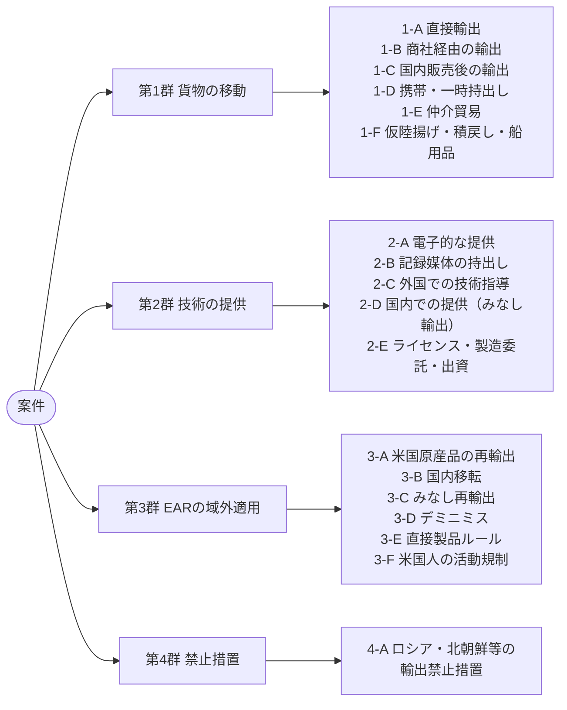
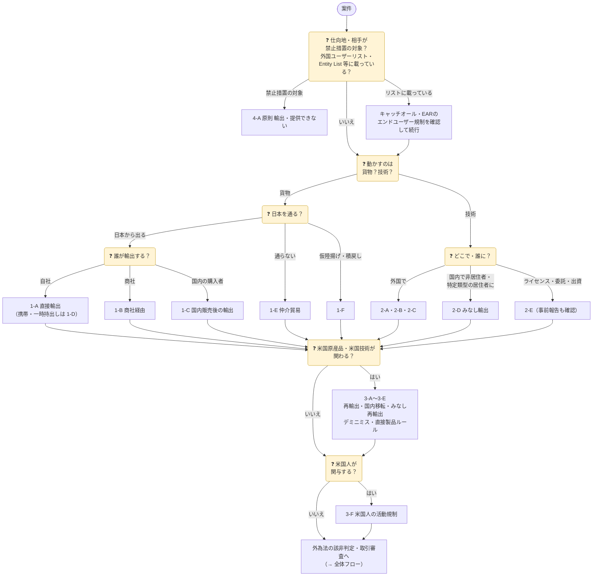

案件が持ち込まれたら、まず「**何を**（貨物か技術か）」「**どう動かすか**（直接か、誰かを経由するか、国内か）」で類型を決めます。類型が決まれば、外為法とEARのどの規定を確認するかがほぼ決まります。

類型コードは審査記録（台帳）に残しておくと、似た案件の判断を後から引けます。

> 2026年11月11日時点の本サイトの各ページ（外為法・輸出令・外為令・役務通達、15 CFR）をもとにした整理です。根拠の詳細は各行のリンク先で確認してください。

## 類型の全体像

1つの案件が複数の類型に当たるのが普通です。たとえば「米国製部品を組み込んだ自社製品を、商社経由で中国へ輸出し、据付に技術者を派遣する」なら、1-B・2-C・3-D（場合により3-E）を確認します。

## 類型ごとの確認事項


{}
| コード | 類型 | 典型例 | 外為法 | EAR | 着眼点 |
|:-:|---|---|---|---|---|
| **1-A** | 直接輸出 | 自社が輸出者として海外の顧客・**自社の海外子会社**へ出荷 | 48条1項。輸出令別表第1の**1〜15項**（リスト規制）・**16項**（キャッチオール）。特例は輸出令第4条 | 日本にある米国原産品などを日本から出すのは「輸出」ではなく**再輸出**（§ 734.14）→ 3-A・3-D・3-E | 自社グループ内でも輸出。契約上の買主と**実際の需要者**が同じか |
| **1-B** | 商社・代理店経由の輸出 | 国内の商社に売り、商社が輸出者になる | 許可を取るのは**輸出する者**（通常は商社）。メーカーは該非判定書・需要者情報を正しく渡す | EARの対象品なら、商社・フォワーダーを含め取引に関わる者すべてが違反の主体になり得る（§ 764.2） | 「国内向けの販売だから関係ない」と考えない。該非判定書の版・前提スペックが出荷品と一致しているか |
| **1-C** | 国内販売後の輸出 | 国内の顧客が購入後に海外へ転売・持出し | 国内での販売そのものは輸出ではなく、許可は要らない。ただし無許可輸出を**知りながら**手助けすれば、共犯として責任を問われ得る | 対象品なら、販売先の変更は国内移転（3-B）、購入者の輸出は再輸出。「知り得べき理由」（reason to know）も knowledge に含まれる（§ 772.1） | 顧客の業態（輸出商社・ブローカー）、外国仕様の電源・外国語マニュアルの要求、納入先が保税地域・港湾、該非判定書だけを求められる |
| **1-D** | 携帯・一時持出し | 出張者のPC・サンプル・測定器、展示会への出品、修理品の返送、デモ機の貸出し | 手荷物・別送品・無償・一時的でも**輸出**。特例は無償告示の類型に当たる場合だけ（→ [05 無償特例](../../05-exceptions/#無償特例無償告示)） | 許可例外 **BAG**（§ 740.14）・**TMP**（§ 740.9）などの条件を確認（→ [許可例外](../../10-us-ear/license-exceptions/)） | 無償告示に**無償サンプル・営業用の貸出し・日本からの展示会出品**の類型はない。展示後の現地売却・譲渡を契約で止める |
| **1-E** | 仲介貿易（三国間） | 貨物は日本を通らず、A国からB国へ。日本企業が売買契約の当事者 | 25条4項・外為令17条5項。<strong>1項（武器）</strong>は全部。**2〜16項**は、船積地域・仕向地の**どちらもグループA以外**で、大量破壊兵器等の開発等に使われるおそれ（省令の要件・インフォーム）がある場合 | 日本企業が手配しても、EARの対象品の再輸出・移転には許可の要否がある。無許可を知りながら手配すれば § 764.2 の違反になり得る | 貨物が日本の税関を通らないので、社内審査だけが歯止め。船積書類・原産地・最終仕向地を照合 |
| **1-F** | 仮陸揚げ・積戻し・船用品 | 日本で積み替える外国貨物、保税地域からの積戻し、外国貿易船への船用品 | **外国向け仮陸揚げ貨物**は輸出令第4条第1項第1号で原則許可不要。ただし**1項**の貨物は許可が必要で、グループA以外向けは大量破壊兵器等のおそれ（省令の要件・インフォーム）があれば許可が必要。船用品・航空機用品は第2号イ（1項を除く） | 第三国での積替え・通過も再輸出。ロシア・ベラルーシなど特定国での積替え・通過は一般禁止事項8（§ 736.2(b)(8)） | 保管中の荷受人・仕向地の変更、船荷証券の仕向地と実際の行き先の食い違い。洋上での瀬取り（積替え）は北朝鮮制裁の典型的な回避手口 |
{}
{}
| コード | 類型 | 典型例 | 外為法 | EAR | 着眼点 |
|:-:|---|---|---|---|---|
| **2-A** | 電子的な提供 | 図面のメール送信、海外拠点から国内サーバー・クラウドへのアクセス、ソフトウェアのダウンロード提供、リモート保守 | 25条1項（提供する取引）。特定技術を記録した媒体の輸出・**電気通信による送信**は25条3項（取引の許可を受けていれば不要） | 技術・ソースコードの開示（release、§ 734.15）は輸出・再輸出に当たる。一定の条件で**エンドツーエンド暗号化**した送信・保管は輸出に当たらない（§ 734.18(a)(5)） | 「提供」は相手が**利用できる状態に置く**こと。閲覧権限（アクセス権）・共有リンクの範囲、退職者・海外拠点のアカウント |
| **2-B** | 記録媒体の持出し | 出張者のPC・スマートフォン・USBメモリに入った技術データ、紙の図面 | 25条1項・3項（特定記録媒体等の輸出）。PC本体は貨物として別に判断（暗号機能は9項。携帯品の特例は 1-D） | 媒体に入った技術を持ち出せば再輸出。PC等は BAG・TMP の条件を確認 | 不要なデータを消してから持ち出す。現地での紛失・入国時の検査で第三者に見られるリスク |
| **2-C** | 外国での技術指導・役務 | 技術者の派遣による据付・保守・修理・研修・コンサルティング | 25条1項。**外国で**の提供は、相手が居住者（日本人の同僚など）でも対象。輸出した貨物の据付・操作・保守のための最小限の使用技術は例外あり（→ [05](../../05-exceptions/)） | 現地での開示は再輸出・みなし再輸出（3-C）。派遣者が米国人なら § 744.6（3-F） | 契約外の改造・性能向上の指導、口頭での設計ノウハウの説明は例外の範囲外になりやすい |
| **2-D** | 国内での提供（みなし輸出） | 国内での外国人社員・留学生・研究者・客先技術者への説明、資料の閲覧 | 25条1項。相手が**非居住者**、又は**特定類型**（2022年5月1日から。①外国法人等との契約で指揮命令に服する ②外国政府等から年間所得の**25%以上**の利益 ③外国政府等の指示・依頼）の居住者（→ [04 みなし輸出](../../04-technology-transfer/#みなし輸出)） | 米国内での外国人（米国市民・永住権者・保護対象の個人以外）への開示は**みなし輸出**（§ 734.13(b)）。日本国内では 3-C を確認 | 入社・着任・入学時の誓約書、兼業・資金受入れの申告制。日本人も特定類型の確認対象 |
| **2-E** | ライセンス・製造委託・出資に伴う提供 | 海外企業への技術ライセンス、製造委託先への製造技術の提供、合弁会社への出資と技術移転 | 25条1項。リスト規制に当たらなくても、**重要管理対象技術**をグループA以外へ提供する場合は**契約前に報告**（55条の8、→ [報告告示](../../09-laws/critical-tech-report/)） | 提供する技術に米国由来の技術が混在・由来すれば、再輸出・デミニミス（技術。事前に BIS へ1回限りの報告）を確認 | 契約交渉の段階で提供する資料も「提供」。製造委託先が作った製品が直接製品ルール（3-E）に当たらないか |
{}
{}
| コード | 類型 | 典型例 | 外為法 | EAR | 着眼点 |
|:-:|---|---|---|---|---|
| **3-A** | 米国原産品・技術の再輸出 | 米国から輸入した半導体・計測器・ソフトウェアを日本から第三国へ出す | 日本からの輸出として通常どおり判断（1-A〜1-F） | 再輸出（§ 734.14）。ECCN と Country Chart、Entity List 等、許可例外を確認（→ [10 米国EAR](../../10-us-ear/)） | 「日本の許可を取ったから大丈夫」は誤り。仕入先から **ECCN** を入手しておく |
| **3-B** | 国内移転（transfer in-country） | EARの対象品を、日本国内で別の需要者に転売・譲渡する、又は用途を変える | 国内取引なので外為法の許可は要らない（輸出が予定されていれば 1-C） | 同じ国の中での**需要者又は用途の変更**（§ 734.16）。Entity List 掲載者・軍事エンドユーザーへの転売、軍事用途への転用は許可が必要になり得る | 同じ会社内で設置場所を移すだけで、需要者・用途が変わらなければ国内移転に当たらない |
| **3-C** | みなし再輸出 | 日本の事業所で、米国から受け取った規制技術を**第三国籍の社員**・客先技術者に見せる | 相手が**居住者**で特定類型に当たらなければ、外為法では対象外。非居住者・特定類型なら 2-D | 開示を受ける人の**最も新しい国籍又は永住権の国**への再輸出とみなす（§ 734.14(b)）。国籍国へ許可不要の技術、A:5 国籍者への一定の開示などは除く（§ 734.20） | 外為法は「居住者か」、EARは「国籍」で判断する。**両方**の基準でプロジェクトのメンバーとアクセス権を決める |
| **3-D** | デミニミス | 米国製部品・ソフトウェアを組み込んだ日本製品を第三国へ輸出 | 日本製品として通常どおり判断 | 規制対象の米国原産品の割合が **25%** 以下（E:1・E:2 向けは **10%** 以下）なら対象外。デミニミスが使えない品目もある（§ 734.4、→ [デミニミス](../../10-us-ear/de-minimis-fdp/)） | 分子は**仕向地へ許可が要る**米国原産品だけ。NS 理由などのソフトウェアは貨物と合算しない。**仕向地ごと**に計算して記録 |
| **3-E** | 直接製品ルール（FDP） | 米国の EDA ツール・製造装置・技術を使って日本で作った半導体・装置を輸出 | 日本製品として通常どおり判断 | 製品の範囲と仕向地・需要者の範囲の**両方**に当たれば対象（§ 734.9。Entity List 脚注1・4・5、ロシア・ベラルーシ、先端コンピューティング、半導体製造装置 など） | 米国原産品を1つも組み込んでいなくても対象になり得る。設計・製造に使った**米国の技術・ソフトウェア・装置**まで遡る |
| **3-F** | 米国人の活動規制 | 日本法人に勤める米国籍の役員・技術者が、懸念のある案件の承認・出荷・役務に関わる | 外為法の直接の規制はない（技術の提供を伴えば 2-A〜2-D） | **米国人**（米国市民・永住権者、米国法人とその外国支店、米国内の人）が、大量破壊兵器・軍事情報・先端半導体の開発・製造等を**支援**するには許可が必要（§ 744.6）。品目がEARの対象でなくても適用 | 米国企業の**日本支店**は米国人、**日本子会社**は米国人ではない。米国籍社員を懸念案件の承認ルートから外す |
{}
{}
| コード | 類型 | 典型例 | 外為法 | EAR | 着眼点 |
|:-:|---|---|---|---|---|
| **4-A** | 輸出禁止措置 | ロシア・ベラルーシ向けの汎用品・ぜいたく品、北朝鮮向けのすべての貨物、指定団体（第三国の団体を含む）向けの取引 | 48条3項の**承認**（輸出令第2条・別表第2の3、附則第3項）。技術の提供などは25条6項・外為令第18条（告示）。リスト規制・キャッチオールとは**別枠**で、非該当品も対象になり得る（→ [01 早見マトリクス](../#0-輸出できる早見マトリクス)） | ロシア・ベラルーシ等は Part 746（一般禁止事項6）。米国財務省（OFAC）の制裁は別の規制 | 第三国（別表第2の4 の地域など）経由の迂回。仕向地がロシア等でなくても、需要者・最終仕向地が指定団体でないか |
{}


## 判断の順番

その後の該非判定・取引審査・許可申請の流れは → [01 全体像の全体フロー](../#1-全体フロー)

## 見落としやすい点

{}
- **国内の外国籍社員**への技術の提供は、相手が居住者で特定類型に当たらなければ外為法では対象外ですが、EARでは国籍国への**みなし再輸出**（3-C）になり得ます。
- **国内での転売**は外為法では輸出ではありませんが、EARの対象品なら**国内移転**（3-B）として確認が必要です。
- 日本から米国原産品を出すのは、EARでは「輸出」ではなく**再輸出**です。
{}

{}
- 「無償のサンプルだから無償特例」 → 無償告示に無償サンプルの類型はありません。該当品なら許可が必要です。
- 「展示会に出してすぐ持ち帰るから特例」 → 日本から外国の展示会への出品は、無償告示の類型にありません（返送の類型は、外国から日本の展示会に出品された物）。
- 「仲介貿易は貨物が日本に来ないから関係ない」 → 25条4項の許可の対象です。
- 「§ 744.6 は米国人の活動を全面禁止している」 → 対象の活動を支援するには**許可が必要**という規制です。対象は大量破壊兵器・軍事情報・先端半導体などの活動に限られます。
{}

{}
- 案件ごとに当てはまる類型コードを**すべて**記録し、類型ごとに確認した規定と結論を残します。
- 1-C・3-B のように「国内取引だが輸出・移転が予定されている」案件は、顧客から**用途・需要者・再輸出の予定**についての誓約書を取り、その写しを一緒に保存します。
- 記録の保存は → [07 社内体制](../../07-compliance-cp/)
{}
